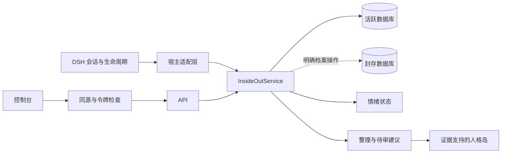

# 总体设计与瀑布阶段基线

[文档导航](README.md) · [当前交付状态](08-delivery-report.md)

> 本文中的 1.0–1.2 为历史开发阶段编号；当前包版本为 `0.0.1`。验收结果仅适用于记录中注明的工件与执行范围。

## 交付定义

交付物是可由 DSH 插件管理器安装的 `dsh-pseudo-insideout` npm 格式包，同时提供中文控制台、完整源代码、自动测试、瀑布文档及独立演示启动器。演示启动器用于核对插件控制台和核心，并不等同于 DSH 接入成功。电影只作结构灵感；不复用电影人物形象和素材。

## 瀑布流程与门禁

| 阶段 | 产出 | 进入下一阶段的条件 |
|---|---|---|
| 需求 | 01-requirements.md | 用户硬约束转为可验收条款；不推迟必需模块 |
| 总体设计 | 本文、research-dsh.md | 宿主契约和存储一致性策略有来源 |
| 详细设计 | 03-contracts.md、console-design.md | 数据、API、生命周期、界面交互冻结 |
| 实现 | src/core、src/http、src/dsh、web | 按已冻结接口实现；变更有记录 |
| 验证 | 单元、故障、接口、宿主契约、浏览器检查 | 硬约束通过；未验证事项明确标注 |
| 交付维护 | README、安装包、验收报告 | 安装来源、迁移、备份、停用、回滚可执行 |

各阶段不以用户重复确认作为门禁。发现缺陷回溯对应设计、修改并重测，不将瀑布误解为禁止纠错。当前没有承诺实际部署或发布到 npm。

## 模块

宿主层只负责路由、生命周期、提示上下文、模型调用和UI入口；核心不依赖DSH对象。所有变更通过同一个服务进入事务，不允许浏览器直接写文件。

## 存储

一个 profile / workspace / agent 对应一个数据根。`active/insideout.sqlite` 存活跃记忆、检索索引、无正文locator、配置、情绪、已完成turn去重、授权票据、待审建议、人格岛及无正文日志；`archive/insideout.sqlite` 独立存封存记忆及独立索引。普通召回只连接活跃数据库。目录内容不打包、不提交。

SQLite采用 DELETE 回滚日志及 FULL 同步。移动时按需 ATTACH 档案库、在单事务中复制、删除源索引、切换 locator、处理派生依赖，提交后 DETACH。跨库一致性依赖 SQLite 本地文件系统与磁盘 fsync 语义；不支持网络盘。文件系统故障则整个操作报错，不先删后写。升级用 user_version，遇未知较新版本拒绝写。

封存不会删除历史版本。原文与解释分开，纠错产生新版本。派生摘要在任一源封存时也进入档案；相关人格岛暂停、建议过期，避免间接重现已封存正文。恢复一个原文不会自动恢复整条派生链，用户分别恢复，且所有依赖必须活跃。

## 召回与预算

先范围过滤（当前 session 与明确 workspace 共享），排除虚构和过期依赖。宿主模型可在有限活跃候选内选择语义命中，结果再核对 ID、证据版本、日期和人物；无模型时使用中文二元词、英文词及有限双语概念回退。排序综合相关度、重要度、时间、情绪注意与用户固定工作记忆。模型可调用只读活跃记忆工具，不能由此读取档案。核心和长期事实仍受保留位与总预算限制；这里没有 embedding 服务。

衰减只影响排序；默认后台整理仅提出90天以上低活跃事件的封存建议。低分不会自动删除或悄悄封存。事实、承诺、偏好、核心记忆不因年龄自动淘汰。上下文硬上限按字符保守控制，实际 token 数取决于宿主模型；不声称字符等于token。

临时调阅是显式授权例外：票据绑定session且有期限，第一次符合条件的turn认领，同一turn重试可复用，其他turn不可再使用。它不把记忆恢复活跃。若DSH把已注入上下文序列化进入会话历史，插件无法撤销历史；必须向用户说明。

## 情绪与成长

六维状态 joy/sadness/fear/anger/disgust/curiosity 均在0..1区间，按时间指数回落。模型分析需严格JSON、置信度门槛和步长上限；失败保持自然衰减，不随机填值。正文、来源真伪与工具授权不受情绪改变。

核心记忆、摘要、人格岛和跟进都先形成建议。批准需要证据版本仍有效。人格岛表示稳定倾向的可编辑假设，不能自称心理诊断；用户身份信息与agent人格底稿分开。主动模块只在控制台列待办，不自动发消息。用户可完全停用状态影响而继续记忆功能。

## 失败与资源边界

- SQLite并发busy超时后返回明确错误；客户端使用expectedVersion防止覆盖。
- 模型分析失败不影响已有记忆，不虚构状态更新；可继续记录原话。
- 达捕获配额时记录跳过原因，不触碰已存记忆。
- 未绑定会话显示未连接，不能将演示数据伪装成真实DSH状态。
- 暂停配置分别控制捕获、情绪和整理；主开关停用提示注入与自动捕获。
- 日志不存内容和令牌。备份仅在用户明确导出时产生；无隐蔽副本。

## v1范围与延伸边界

本版包含所有八个功能领域的可执行路径：记忆球、工作上下文、情绪、召回、核心、人格岛、整理、封存修复以及控制台。多模态原始媒体保管、跨设备同步、外部向量服务、自动外发关怀、独立情绪多agent并行不属于本版范围。它们不影响用户已确定的硬要求，也不得被标成已实现。

## 1.1 来源闭包与状态历史

模型提炼记录所有实际送入模型的背景来源，不能只信任模型自报的引用。背景源封存、修订或删除时，后续用户原话保留，受影响元数据退回本地提炼；旧提炼历史、人格历史和相关建议移入独立档案，删除时一并清除。用户画像、agent 人格、身份底稿与会话工作台分别保存。回收箱实际位于档案库，不创建隐蔽撤销副本。详情见 [1.1 补齐设计](10-growth-completion.md)。

## 1.2 策略与显式导入扩展

core/policy.js在profile根保存默认开关；每个scope共享该store，各自active库保存session覆盖与import_access。core/import-file.js只解析用户所选文本，core/imports.js负责预览、依赖闭包、幂等与事务提交。DSH session-import.js从公共sessionQuery接口读取当前工作区/角色历史；HTTP扩展只提供可信快照，核心不打开宿主私有持久化路径。host.js在采集、提示、工具和异步调用前后校验策略版本，阻止同轮关闭再开启恢复旧采集。完整边界见[1.2基线](11-session-policy-import.md)。
