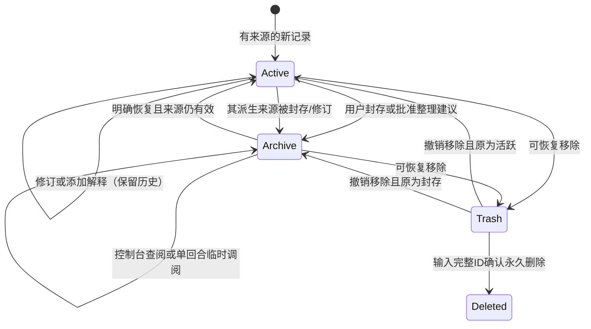

# 详细行为与算法设计

## 1. 记忆状态机

分数下降、情绪回落、过久未访问、配额已满、关闭插件都不会触发 Deleted。Active 中未命中某一轮查询仅表示这轮没有被选中，不等于从活跃候选中移除；一旦退出日常候选则进入 Archive。

## 2. 数据权属与真实来源

- 一个 profile/workspace/agent 为一个不可跨越的数据范围。主进程使用真实 profileContext.dir、session.header.cwd 与 agentPreset 的hash定位。
- session 私有记录只对来源会话可见；workspace 是用户显式共享的当前范围，不跨工作区。
- 助手、模型、导入和用户陈述保留来源标签；虚构经历不参加默认事实召回。
- 修订只更新可编辑表示并保存旧版本，原文/来源/原始事件时间不可改写。
- 原文表示“来源曾这样说”，不因此保证内容客观真实。

## 3. 查询步骤与排序

1. 读取主开关和本连接的 SQLite data_version；其他实例提交变更时清空缓存。
2. 筛选当前会话及显式共享记录；排除虚构和证据失效的派生内容。
3. NFKC规范化、小写英文、中文连续字串二元词；计算正文、标题、标签和实体命中。
4. 相关度取词法与语义分数的较大值。总分为 `0.55*相关度 + 0.20*重要度 + 0.12*鲜活度 + 0.05*最大情绪强度 + 0.08*当前情绪亲和度`，核心加0.15，用户固定工作记忆加0.5。情绪影响始终有限，不改变事实或权限。
5. 鲜活度为 `0.5^(距事件天数/halfLifeDays)`；长期事实/偏好/承诺/核心不按时间衰减。
6. 普通事件可由词命中、受控语义匹配或明确日期/人物条件进入候选；持久事实、核心及固定工作记忆受预算约束。活跃派生关系允许补充关联候选。语义模型只见有限活跃候选，返回后重新校验范围、版本和过滤条件；离线有限概念表不等同通用语义理解。
7. 临时授权候选优先；若预算容纳不了整条，提供命中附近的明确摘录，并标记 truncated/originalChars，数据库原文保持不变。
8. 总输出字符上限、条数上限同时生效；不把字符数宣传为模型 token 精确计量。
9. 当前身份、表达偏好、模拟情绪和批准的人格倾向也占同一预算。整个块明确是低信任参考资料。

正常查询不会调用档案库；只有存在有效显式调阅票据时才按ID连接档案。全局UI档案浏览是独立用户动作。控制台分页支持 offset 与 core=true，避免旧核心被第一页掩盖。

## 4. 临时调阅与缓存

调阅票据只保存记忆ID、session、过期时间与认领turn，不保存正文。有效期10分钟。第一次注入时条件更新认领turn，并检查SQLite changes；竞争失败的另一个turn不得返回正文。同turn重试可复用缓存；provider仅peek，不重复消费票据、不写日志。

封存/删除/修订/停用使缓存失效；多个进程通过主库 data_version 检测变更。跨库移动总是修改主库目录，确保失效信号可见。临时授权只约束“本插件新注入”，不撤回DSH已经保存的会话历史。

## 5. 情绪与人格

每轮真实完成后可复用宿主模型进行一次最多3000输出token、15秒超时、无工具的JSON提炼，同时返回记忆元数据、情绪和待审建议。模型不接收助手正文，用户原话与有限活跃证据按预算输入；助手文本仅随本轮原始来源保存。另有回合前语义选择，最多1200输出token、5秒超时，每回合一次。两者分别由 analyzeTurns 与 semanticEnabled 控制，关闭情绪并不关闭记忆提炼。

仅接受六维0..1有限数、合法置信度及短理由。默认低于0.7不应用，每维单次变化最多0.2，按3小时半衰期回落。失败时记忆使用保守本地规则、情绪保持自然衰减。日期推断使用配置时区，拒绝无效日期和夏令时歧义；明确 ISO 偏移保持原含义。

身份底稿（用户设置）不由梦工坊自动重写。人格岛至少三条同范围、跨两个当地日期的证据，支持偏好、关系、习惯、价值与兴趣。自然对话提炼只建立关于用户的候选，不把用户偏好写成 agent 身份。批准、编辑、停用、回退都保存成长记录。来源失效后历史描述进入 cold.artifacts，活跃库仅留停用状态。显式恢复封存人格须所有来源活跃且指纹不变，恢复后仍停用。

## 6. 梦工坊

每次最多扫描1000条、累计100万存储字符，最多100个新候选；持久游标推进下批，返回 scanned/scannedChars/skippedOversize/hasMore/proposalLimitReached。超大单条仅从本轮整理跳过，原文仍保留。跨批次的主题不会假装已经全库综合。

| 类型 | 生成依据 | 批准后的变更 |
|---|---|---|
| archive | 普通事件超过配置天数、重要度<0.6且非核心 | 跨库事务封存 |
| core | 重要度≥0.9；或至少三条跨日同主题记录中重要度≥0.6的代表，且尚非核心 | 标记核心 |
| summary | 同范围重复或共享主题的不同表述至少两条；模型也可提出证据化归纳 | 新增引用本候选所选来源（最多20条）的反思，不删除原文 |
| association | 模型提出至少两条有效来源的关联，或离线同实体不同陈述横跨多个主题 | 新增有来源的反思，不改变原文 |
| island | 同范围至少三条、跨两个当地日期的主题/画像证据 | 新建可停用的倾向岛 |
| conflict | 同范围同类别同实体有不同陈述 | 只标已核对，不选择哪条是真的 |
| followup | 已到期或未指定日期的约定、用户开启建议、非安静时段且达到会话频率间隔 | 记录控制台待办，不向外发消息 |

宿主每分钟检查后台维护，各数据范围至少间隔一小时且受安静时段约束。对话完成或手工整理仍可生成普通建议，但安静时段不生成跟进。每个建议保存证据ID和版本；主题、归纳与冲突候选各最多选取20条来源，并非全库或全部同类记录的证明。批准前重新校验，拒绝和过期不能重新批准。源修订后封存旧派生链；恢复时比对来源内容/范围hash，不能恢复已过期的结论。可以基于新证据建立新归纳，旧版继续封存。

## 7. 事务、索引与删除

跨库移动必须在 ATTACH 后 BEGIN IMMEDIATE，同事务写目标、删源正文及FTS、更新catalog和派生状态，提交后DETACH。主库与档案都使用 DELETE journal / FULL synchronous，禁止改WAL却保留跨库原子性承诺。

主库与档案启用 `PRAGMA secure_delete=ON` 和 FTS5 `secure-delete`，避免只写FTS tombstone留下词项。明确删除处理原文、修订、摘要、相关解释、人格与建议的当前库及封存快照；日志只记ID与操作元数据。系统备份、SSD和宿主历史不在擦除保证内。

无效JSON/最小结构损坏记录被逻辑隔离、保持原字节不动，state.storage.issues报告ID。依赖坏源的派生记录退出召回，无关健康记录继续使用。SQLite整库物理损坏则需从明确备份恢复，不声称能自动修复任何损坏。

## 8. 宿主与界面职责

`agent/pre-step` 收集真人源查询、可选语义选择并buildContext，动态SystemPrompt provider只读取当前有效缓存。`session/event`只在`turn/end`且reason=completed时最终捕获；取消、失败、子agent不伪装成已完成事件。session+turn为幂等边界。插件卸载先取消模型任务、等待已完成原话落盘，再撤销监听与关闭库。

HTTP层校验实际loopback socket、Host、Origin和随机令牌，地址判断不信任Forwarded头；静态资源使用固定白名单，并拒绝非JSON与超大数据请求。UI通过文本节点展示记忆，不执行正文HTML；scope切换丢弃旧范围请求。外部模型通道只沿DSH已有配置，没有额外密钥或云同步。

## 9. 运维故障矩阵

| 故障 | 行为 |
|---|---|
| 模型不可用/超时/JSON无效 | 原话可保存，情绪不更新，日志元数据标记失败 |
| 并发修订 | expectedVersion冲突409，保留已提交版本 |
| SQLITE_BUSY | 返回可重试失败，不覆盖数据 |
| 磁盘满/移动途中退出 | 回滚或恢复为移动前状态，不留下只删源的成功状态 |
| 归档路径暂不可访问 | 普通活跃召回仍可工作；档案操作失败 |
| 超大输入/当日捕获配额满 | 明确跳过新捕获，保留既有记忆与宿主历史 |
| schema高于程序 | 拒绝写入，要求使用兼容程序 |
| 备份损坏或目标已有 | 恢复拒绝，不覆盖原目录 |

代码入口：`src/core/service.js`、`src/http/api.js`、`src/dsh/host.js`、`web/app.js`、`scripts/backup.js`。

## 10. 模型背景依赖与回收箱

模型提炼、情绪和建议记录全部实际送入的背景来源，不能依赖模型自报引用。背景失效时，后续原话保持活跃；模型元数据退回本地规则，旧提炼和相关派生历史显式封存，召回快照与情绪理由清除。永久删除背景源时清除相关档案元数据及派生内容。模型分析期间来源版本发生变化时，整批结果降级，不接收旧情绪或建议。

回收箱存于独立档案库，不自动清空，禁止临时调阅。撤销移除回到此前层级；由来源移除而封存的派生项仍需分别恢复。批量封存/恢复预先校验全部版本，任一失败整体回滚；恢复可同时选择源与派生，不依赖选中顺序。HTTP 仍保留需完整ID确认的 DELETE 兼容接口，控制台将永久删除入口放在回收箱中。

## 1.2 策略版本与导入快照

会话有效状态由空间硬暂停、会话inherit/on/off和profile默认共同决定；策略stamp包含相关默认版本、覆盖版本与空间暂停版本。版本变化清缓存并取消辅助调用，当前回合进入禁止采集状态，下一完整回合重新计算。即使off→on最终布尔相同，也不能沿用旧回合或异步结果。独立数据库连接造成的版本变化在提示、工具、事件和异步结果边界重验。

已有记忆导入冻结所选根记录及sourceIds/analysisEvidenceIds/解释依据闭包；先完整披露，再在事务内重验版本并授予目标会话引用。DSH历史只接受当前有效surface中的完成真人回合；历史只读，当前未选择回合和未来新增回合均不自动导入。文件解析保留外部参考归属，原始连续文本与hash可追踪；提炼与导入均不自动批准人格。细则见[1.2基线](11-session-policy-import.md)。
